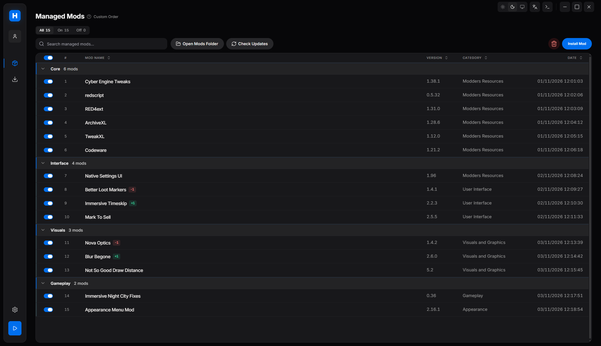
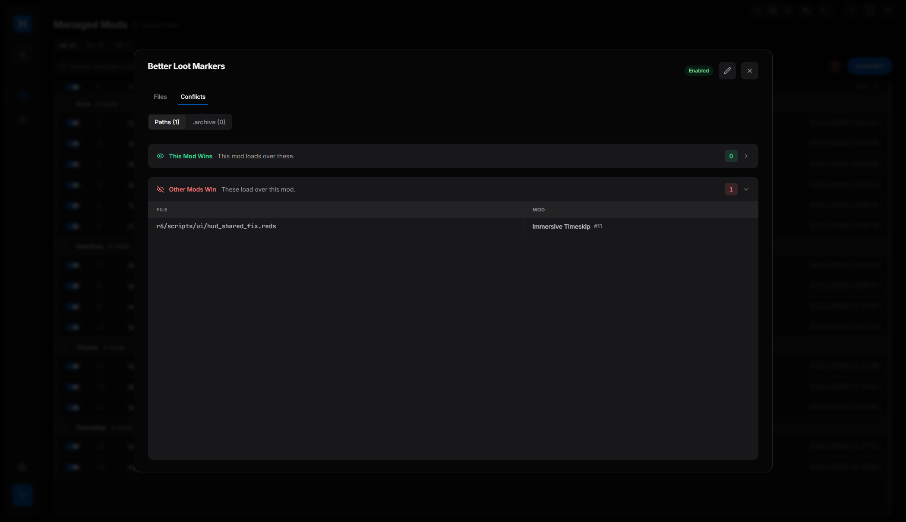
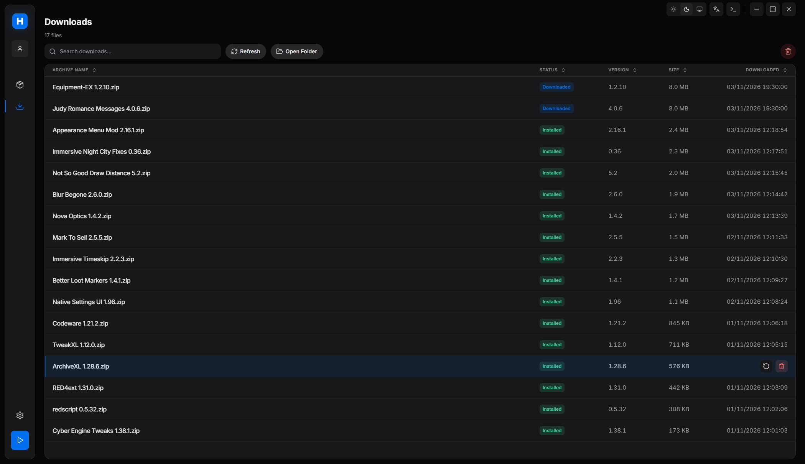
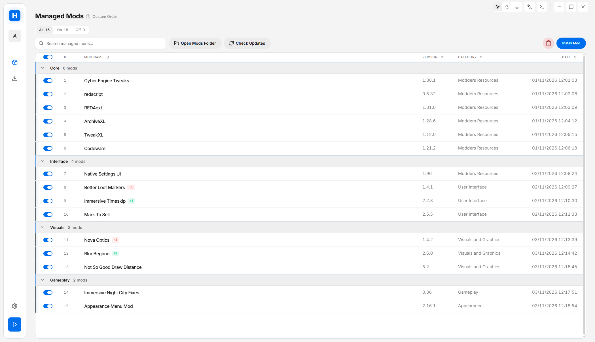
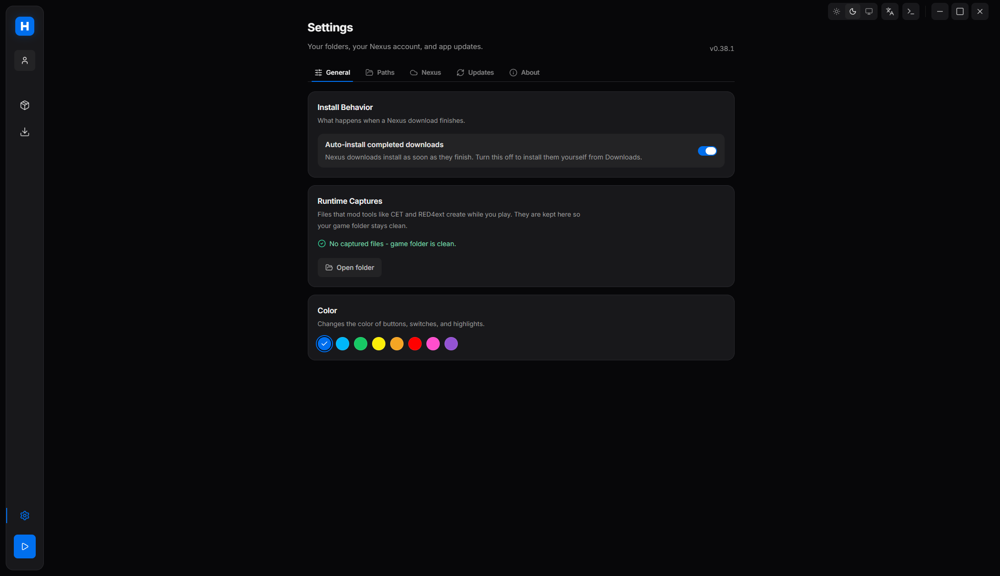

# Hyperion

A mod manager for Cyberpunk 2077 on Windows. It keeps your mods organized, shows which ones conflict, and launches the game with your mods loaded, without filling the game folder with mod files.

**Download:** [latest release](https://github.com/caiovaz567/Hyperion-Mod-Manager/releases/latest)

<p>
  
  
  
  
  
</p>

The screenshots use a demo library. The mods are real, but the dates, sizes and conflicts are invented.

## What it does

- **Library:** turn mods on and off, one at a time or in bulk. Group them with collapsible separators and drag them to set the load order. On a shared file, the mod lower in the list wins.
- **Conflicts:** finds mods that replace the same file, and `.archive` files that change the same game resource. Each mod shows what it wins and what it loses.
- **Installs:** handles `.zip`, `.rar` and `.7z`, with a full FOMOD wizard for mods that offer options. You can reinstall from the original archive at any time.
- **Launching:** mods are mounted over the game with usvfs when you press play. No admin rights, and the library can be on another drive.
- **REDmod:** compiles your REDmods at launch, in the order of your library, and keeps the result outside the game folder. It compiles again by itself when your REDmods or the game change.
- **Mod settings:** files that tools like CET create while you play are saved in a separate folder and loaded again next time, so your settings stay.
- **Nexus Mods:** installs from `nxm://` links, and finds updates for the exact file you have installed. Premium accounts can update in one click. Free accounts open the Nexus page and finish from there.
- **Extras:** light and dark modes, eight accent colors, English and Brazilian Portuguese, a built-in log viewer, and automatic app updates.

## Getting started

You need Windows 10 or 11 (64-bit) and a copy of Cyberpunk 2077.

Download the installer from the [releases page](https://github.com/caiovaz567/Hyperion-Mod-Manager/releases/latest). The first time you open Hyperion, it asks for:

1. **Game:** where Cyberpunk 2077 is installed. It usually finds this by itself.
2. **Mod library:** the folder that holds your installed mods.
3. **Downloads:** the folder for your mod archives. Optional.
4. **Nexus:** your [personal API key](https://www.nexusmods.com/settings/api-keys), for downloads and update checks. Optional.

You can change all of this later in Settings.

## Technologies

- **App:** Electron with TypeScript, React 19, HeroUI v3, Tailwind CSS 4 and Zustand.
- **Mod mounting:** [usvfs](https://github.com/ModOrganizer2/usvfs), the virtual file system from Mod Organizer 2, through a small native Node.js bridge.
- **Publishing:** electron-builder and GitHub Releases, which also deliver the automatic updates.
- **Tests:** Vitest for the risky logic, and a Playwright test that drives the real app in a throwaway profile.

## Design decisions

- **The game folder stays clean.** Almost everything is virtual. The few loader files that must exist before the game starts, such as CET's `version.dll`, are copied in for the session and removed when the game closes, even after a crash.
- **No game version in the code.** Hyperion does not check for a specific game version, and it notices a patch by itself. Mods like CET and RED4ext may still need their own updates after a patch.
- **Your Nexus key stays protected.** It is stored encrypted, and the interface never receives it once it is saved.
- **Few Nexus requests.** The automatic check runs at most once an hour when the app opens. It asks Nexus what changed, then looks only at the installed mods on that list.
- **Mod archives are not trusted.** Paths inside a FOMOD can't write outside the install folder, and download names can't write outside the Downloads folder.
- **Updating never deletes your mods.** The uninstaller removes only Hyperion's own files, so a `Mods` folder next to the app is safe.

## Structure

```
src/
  main/       Electron main process: launching, usvfs, settings, updates
    ipc/      installer, mod library, conflicts, Nexus
  renderer/   the interface
    features/ library, downloads and shared UI
    i18n/     translations (one JSON file per language)
    store/    app state
  shared/     types and theme used by both sides
native/       native bridge to usvfs
tests/        Vitest tests
  e2e/        Playwright test of the real app
scripts/      build and release helpers
```

## Building from source

```sh
npm install
npm run fetch:usvfs   # download the pinned usvfs release
npm run build:native  # build the native bridge
npm run dev           # run in development
npm run build         # build a local installer
```

```sh
npm test              # Vitest
npm run typecheck     # TypeScript
npm run test:e2e      # Playwright, on the real app
```

## How it was made

Hyperion started as a small personal experiment: I wanted to try Claude Code, had just started modding Cyberpunk 2077, and thought building a mod manager for my own setup would be a fun test project. Then the fun part got a little out of hand.

It became the manager I use for my own mod list, and it grew around the things I wanted day to day: a clean library, clear conflicts, a predictable load order, and a game folder that stays under control.

It is built with AI assistance. I use Claude Code to help write, debug and document the code, and I test the changes before each release.

## Credits

- **Brazilian Portuguese translation:** [Roberth Souza (@Roberth-Souza)](https://github.com/Roberth-Souza)

## License

Hyperion is free software, licensed under the [GNU General Public License v3.0](LICENSE).

It bundles these components, unmodified and under their own licenses:

- [usvfs](https://github.com/ModOrganizer2/usvfs) (GPL-3.0, © Sebastian Herbord and Mod Organizer 2 contributors): virtual deployment.
- [WolvenKit](https://github.com/WolvenKit/WolvenKit) (GPL-3.0): the community resource-hash database. It contains no game assets, only hashes and the resource paths they resolve to.
- [7-Zip](https://www.7-zip.org/) (LGPL, © Igor Pavlov): archive extraction.

See [`THIRD_PARTY_LICENSES.md`](THIRD_PARTY_LICENSES.md) for the full notices.

Hyperion is an unofficial, fan-made tool and is not affiliated with or endorsed by CD PROJEKT RED or Nexus Mods.
